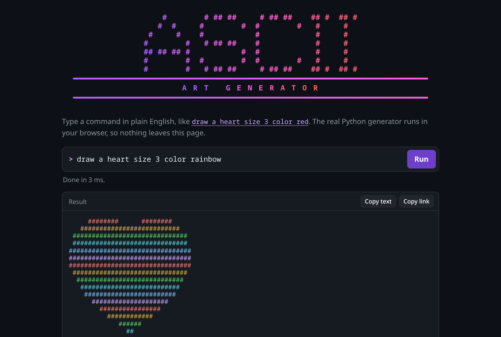
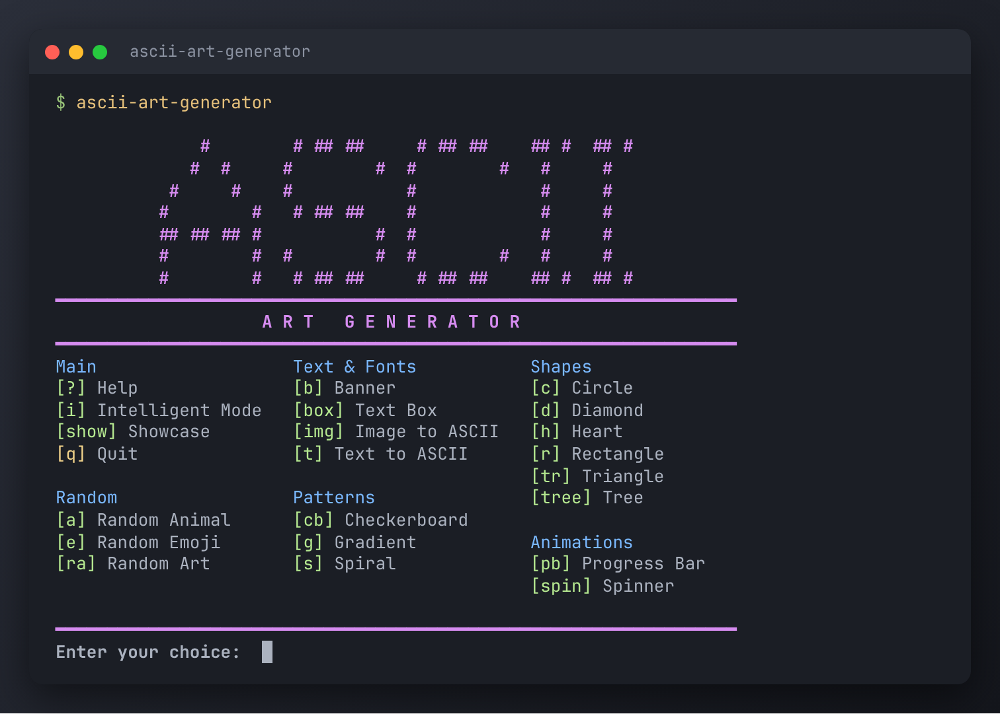
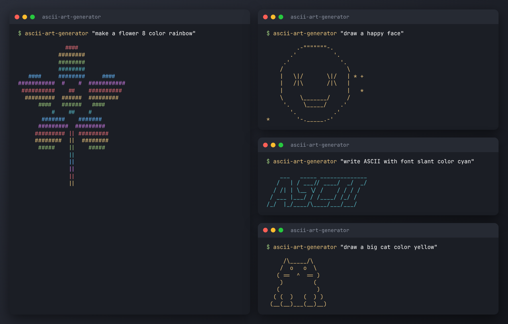

# ASCII Art Generator

[](https://github.com/JoaoTomas991/ascii-art-generator/actions/workflows/ci.yml)
[](LICENSE)


Draw ASCII art by typing plain English: shapes, text, patterns, emoji faces, animals and your own images. It runs in the terminal, and in your browser with nothing to install.

**[Try it in your browser](https://joaotomas991.github.io/ascii-art-generator/)** (nothing is uploaded; the Python runs on your machine)

[](https://joaotomas991.github.io/ascii-art-generator/)

## Quick start

```bash
pipx install "ascii-art-generator[all] @ git+https://github.com/JoaoTomas991/ascii-art-generator.git"

ascii-art-generator "draw a heart size 2 color red"   # one command, then exit
ascii-art-generator                                   # interactive menu
ascii-art-generator --intelligent                     # type commands freely
```

No Python? Download a ready-made executable for Windows, macOS or Linux from [Releases](https://github.com/JoaoTomas991/ascii-art-generator/releases). Other ways to install, including Windows notes, are in [docs/installation.md](docs/installation.md).



## What it can do

- **Shapes:** rectangle, circle, triangle, heart, diamond, spiral, tree, star, hexagon, oval, arrow, pentagon, butterfly, flower.
- **Text:** `write HELLO with font slant`, with real FIGlet fonts when `pyfiglet` is installed.
- **Styling:** colors (including `rainbow`), 32 fill patterns and several border styles.
- **Emoji and animals:** a face with a mood (`draw a sad emoji`), or a cat, dog, rabbit, owl and more.
- **Images:** `convert image photo.png width 80 color` turns a picture into colored ASCII.
- **Banners, boxes, patterns and small animations.**
- **Teachable moods:** `teach ecstatic as happy`, remembered between sessions.



## Example commands

```
draw a rectangle 10x5
make a circle with radius 8 color blue
draw a heart size 4 color rainbow
write HELLO with font slant color cyan
make a rectangle 12x5 color cyan style dotted
draw a happy face
draw a big cat color yellow
make a circle with radius 5 color blue and a rectangle 10x5 color red
convert image /path/to/photo.png width 80 color
```

The full list of what is understood, the three ways to run it and the known limitations are in [docs/usage.md](docs/usage.md).

## Documentation

- [Installation and running](docs/installation.md): pipx, virtual environments, Windows, standalone executables.
- [Usage](docs/usage.md): modes, commands, capabilities, limitations.
- [Development](docs/development.md): project structure, tests, the browser build.
- [Architecture decisions](docs/adr/): why things are built the way they are.
- [Contributing](CONTRIBUTING.md)

## License

MIT; see [LICENSE](LICENSE).
