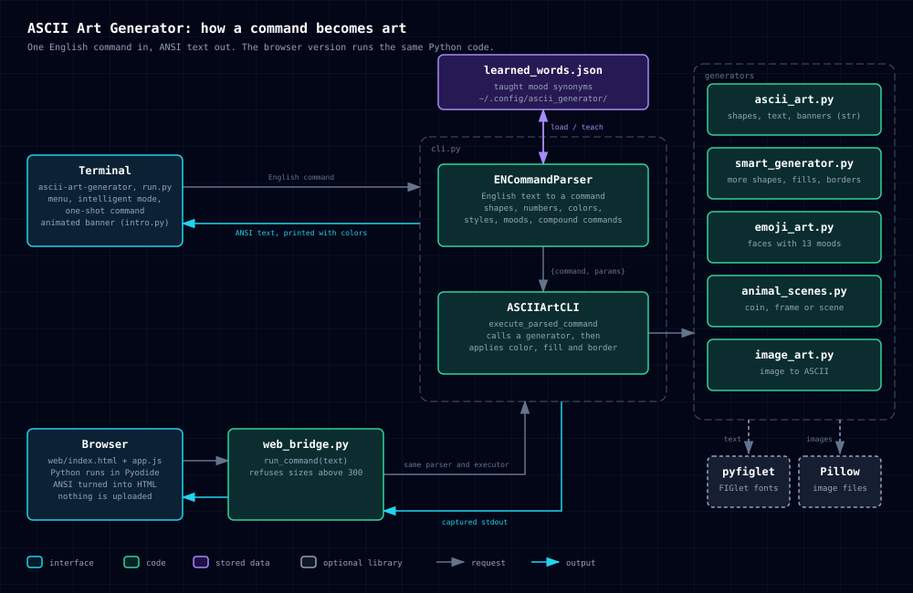

# Development

For the contribution workflow (issues, branches, pull requests) see [CONTRIBUTING.md](../CONTRIBUTING.md).

## Architecture



A command typed in the terminal goes to `ENCommandParser` (in `cli.py`), which turns the English text into a `{command, params}` dictionary. `ASCIIArtCLI.execute_parsed_command` calls the matching generator, then applies color, fill and border, and prints ANSI text.

The browser version runs the same Python code inside Pyodide. `web_bridge.run_command` uses the same parser and executor, captures what they print, and the page turns the ANSI codes into HTML. Taught mood words are the only data that persists, in `learned_words.json`. `pyfiglet` and Pillow are optional: without `pyfiglet` the built-in fonts are used, and without Pillow only `convert image` stops working.

## Project structure

```
ascii_art_generator/
├── ascii_art.py        # base shapes, fonts, patterns, banners, animations
├── cli.py              # ENCommandParser + command-line interface
├── smart_generator.py  # advanced shapes, fill/border patterns, random generation
├── image_art.py        # image-to-ASCII conversion (the one module that needs Pillow)
├── learned_words.py    # persistence for user-taught mood synonyms
├── animal_scenes.py    # random animal in a coin / frame / scene
├── emoji_art.py        # random emoji face composed from head, eyes, brows, mouth and extras
├── console.py          # UTF-8 stdout setup shared by the entry points
├── install_info.py     # `--version` info and stale installed-copy warning
├── intro.py            # animated startup banner and the live menu animation
├── web_bridge.py       # run_command(): runs a command and returns its output (used by the web page)
└── main.py             # entry point

run.py             # startup script (menu / intelligent / direct command)
web/               # static browser version (index.html, style.css, app.js)
scripts/build_web.py  # builds web/ + the zipped package into _site/
setup.py           # packaging; provides the "ascii-art-generator" command
start.sh           # interactive startup menu (Unix only)
Makefile           # run, test and `make web` shortcuts (Unix only)
requirements.txt   # Pillow (image-to-ASCII) and pyfiglet (FIGlet text fonts), both optional
docs/adr/          # architecture decision records
.github/workflows/ # CI (ci.yml), executables (build-executables.yml), GitHub Pages (pages.yml)
```

## Testing

On Linux and macOS:

```bash
make test
```

Everywhere, including Windows, the same two checks without `make`:

```bash
python -c "from ascii_art_generator.ascii_art import draw_rectangle, draw_circle, draw_heart, draw_diamond, text_to_ascii; print('Import tests: OK')"
python -c "from ascii_art_generator.cli import ENCommandParser; p = ENCommandParser(); print('Parser tests: OK')"
```

Runs a smoke test against the main imports and the command parser. CI runs
these on Windows, Linux, and macOS against Python 3.12, 3.13, and 3.14; see
[`.github/workflows/ci.yml`](../.github/workflows/ci.yml).

## Browser version

The live site is <https://joaotomas991.github.io/ascii-art-generator/>.

The `web/` folder is a static page that runs the real generator inside your
browser through [Pyodide](https://pyodide.org) (Python compiled to WebAssembly).
Type the same English commands, pick an example, or convert an image; nothing
is uploaded anywhere. The first visit downloads about 10 MB of Python runtime.

```bash
make web            # builds _site/ and serves it on http://localhost:8000
```

`make web` (or `python3 scripts/build_web.py --serve`) needs no extra packages.
Open `http://localhost:8000/?cmd=draw+a+heart` to start with a command already
run. After you run a command, the page's "Copy link" button copies a link like
that, so you can share a drawing.

To publish it on GitHub Pages, set **Settings > Pages > Source** to "GitHub
Actions" once. After that `.github/workflows/pages.yml` redeploys the site on
every push to `main` that touches `web/`, the package, the build script or the
workflow itself, and it can also be started by hand from the Actions tab.

## Building an executable locally

To build one locally instead (PyInstaller can only target the OS it runs on):

```bash
pip install pyinstaller -r requirements.txt
pyinstaller --onefile --name ascii-art-generator --collect-data pyfiglet run.py
# output: dist/ascii-art-generator (dist\ascii-art-generator.exe on Windows)
```

The same build runs in CI for every `v*` tag; see
[`.github/workflows/build-executables.yml`](../.github/workflows/build-executables.yml).
